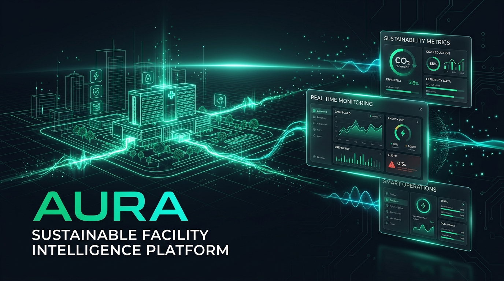
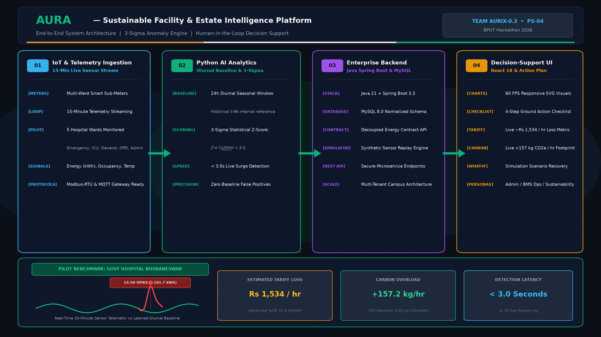
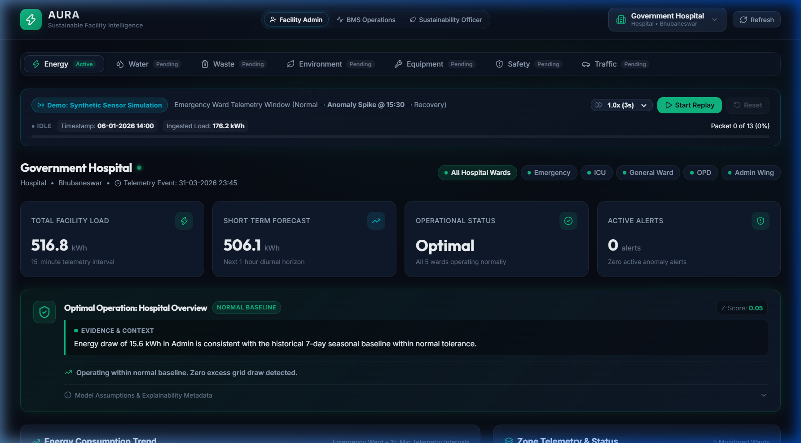
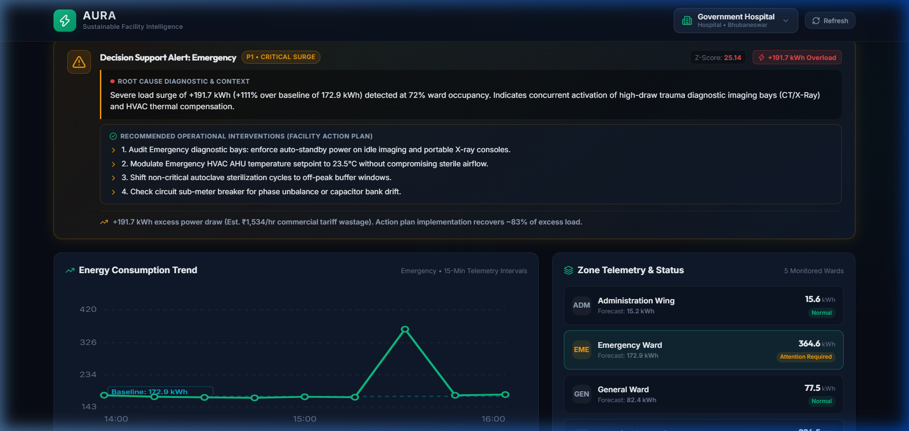

<div align="center">

# 🌿 AURA — Sustainable Facility & Estate Intelligence Platform

**From 30-Day Bill Shocks to Real-Time Actionable Facility Intelligence**

[](https://github.com)
[](https://github.com/AmanSah078)
[](https://github.com)
[](http://localhost:5173)

<br/>



</div>

---

## 📌 Executive Summary

Large public facilities and campuses across India (such as district hospitals, universities, and government administrative complexes) spend upwards of **35% of their operational expenditure on electricity**. Yet, facility managers operate in the dark:
* Traditional energy sub-meters only record passive history without contextual intelligence.
* Receiving an energy bill 30 days later is like **receiving a speeding ticket 30 days after driving** — by then, both financial loss and carbon footprint are irreversible.
* In Bhubaneswar, Odisha, commercial peak tariffs average **₹8 – ₹12 / kWh**. An undetected **190 kWh** equipment overload bleeds **₹1,534+ every single hour** and emits **+157.2 kg CO₂e / hr**.

**AURA** solves this blindspot by continuously ingesting 15-minute multi-ward telemetry, establishing 24-hour diurnal seasonal baselines, detecting statistical anomalies ($Z > 3.0$) in under 3 seconds, and delivering grounded, human-in-the-loop action plans.

---

## 🏗️ System Architecture

AURA is engineered with an enterprise-grade, decoupled full-stack architecture:

<div align="center">

</div>

### 1. Ingestion & Telemetry Layer (`IoT Stream`)
* **15-Minute Polling Loop:** Ingests live telemetry (`energy_kwh`, `occupancy`, `temperature`) across 5 hospital wards:
  * Emergency Ward, ICU, General Ward, OPD, and Administrative Wing.
* **Protocol Ready:** Engineered for Modbus-RTU and MQTT IoT gateway transmission.

### 2. AI & Analytics Engine (`Python / FastAPI`)
* **Diurnal Seasonal Baseline:** Learns cyclic 24-hour consumption curves ($t - 96$ fifteen-minute intervals) for each zone.
* **3-Sigma ($Z > 3.0$) Scoring:** Flags genuine overloads without false alarms during normal peak hours:
  $$\text{Z-Score} = \frac{x_{\text{observed}} - \mu_{\text{seasonal}}}{\sigma_{\text{seasonal}}} > 3.0$$
* **Near-Term Forecasting:** Projects expected load for the upcoming 1-hour horizon.

### 3. Enterprise Orchestration Backend (`Java 21 / Spring Boot 3.3`)
* **Decoupled Intelligence Contract:** Implements strict data firewalls between raw mathematical features and operational decision-support DTOs.
* **Persistent Storage:** MySQL 8.0 normalized relational schema with indexing on facilities, zones, timestamps, and anomaly audits.
* **Synthetic Replay Simulator:** Enables deterministic scenario testing (Normal $\rightarrow$ 15:30 Anomaly Spike $\rightarrow$ Recovery).

### 4. Decision-Support UI (`React 18 / Vite`)
* **High-Performance Visuals:** Pure 60 FPS responsive SVG telemetry charts without heavy chart-library overhead.
* **Role-Based Persona Switcher:**
  * 🏢 **Facility Administrator:** Macro financial tracking, budget burn, and tariff penalty monitoring.
  * ⚡ **BMS Operations:** Real-time ward telemetry, equipment diagnostics, and prescriptive 4-step action checklists.
  * 🌿 **Sustainability / ESG Officer:** CEA carbon emission tracking (0.82 kg CO₂e/kWh) and green compliance.
* **What-If Scenario Simulator:** Allows facility teams to test the recovery outcome before dispatching field crews.

---

## 📸 Platform Screenshots

| 1. Normal Baseline State (Optimal) | 2. Real-Time Anomaly Event (15:30 Spike) |
|:---:|:---:|
|  |  |
| *Clean emerald baseline, 0 active alerts* | *+191.7 kWh overload, pulsing radar alert, ₹1,534/hr loss* |

---

## 🛠️ Tech Stack

| Domain | Technologies |
|---|---|
| **AI / Machine Learning** | Python 3.12, FastAPI, Uvicorn, NumPy, Pandas, Scikit-learn, Time-Series Diurnal Lag Modeling |
| **Enterprise Backend** | Java 21, Spring Boot 3.3, Spring Data JPA, Hibernate, Maven |
| **Database** | MySQL 8.0 Relational Engine |
| **Frontend Dashboard** | React 18, Vite, Vanilla CSS, Lucide Icons, Pure SVG Visuals |
| **Protocols & Standards** | Modbus-RTU / MQTT IoT specifications, Central Electricity Authority (CEA) Carbon Factor (0.82 kg CO₂e/kWh) |

---

## 🚀 Quick Start Guide

### Prerequisites
* **Java 21 JDK** & **Maven**
* **Python 3.12+**
* **Node.js 18+** & npm
* **MySQL 8.0** running on `localhost:3306`

### One-Click Launch (Windows PowerShell)
Clone the repository and run the automated startup script:

```powershell
git clone https://github.com/AmanSah078/AURA-Sustainable-Facility-Intelligence-For-India.git
cd AURA-Sustainable-Facility-Intelligence-For-India
.\run_project.ps1
```

The script initializes all 3 tiers simultaneously:
1. **AI Engine:** `http://127.0.0.1:8000/docs`
2. **Spring Boot Backend:** `http://127.0.0.1:8080/api/v1/energy/intelligence`
3. **Frontend Dashboard:** `http://localhost:5173/`

### Manual Execution

```powershell
# 1. Start Python AI Engine
python -m uvicorn ai_engine.api:app --host 127.0.0.1 --port 8000

# 2. Start Spring Boot Backend
cd backend
mvn spring-boot:run

# 3. Start React Frontend
cd ../frontend
npm install
npm run dev
```

---

## 👥 Team AURIX-0.3

* **Aman Sah** ([@AmanSah078](https://github.com/AmanSah078)) — Team Lead, Full-Stack Architecture, Spring Boot REST Microservices, React Dashboard & Explainable AI.
* **Md Tausif Raza** — System Architecture Ideation, Diurnal Machine Learning Research & Hospital Domain Modeling.
* **Nitish Kumar** — Sub-Meter Data Requirements Research, MySQL Schema Support & Synthetic Replay Validation.

---

## 📜 License
Developed for **BPUT Hackathon 2026 (Problem Statement PS-04)**. Released under the MIT License.
